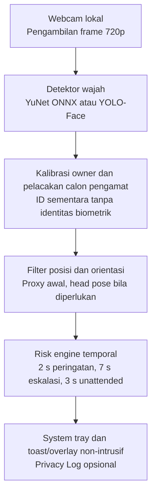
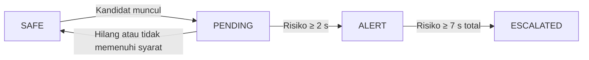

# LAPORAN PENDEKATAN TEKNIS

# Anti-Kepo

**Deteksi Potensi Shoulder Surfing dengan Computer Vision Lokal**

| Informasi | Keterangan |
|---|---|
| Jenis dokumen | Laporan rancangan sistem, pemilihan model, dan rencana eksperimen |
| Target produk | Aplikasi desktop ringan, offline, dapat diinstal di Windows dan macOS |
| Teknologi awal | Python, OpenCV, YuNet ONNX, MediaPipe (opsional), PySide6 |
| Tanggal | 2 November 2026 |
| Dasar | Dokumen Studi Kasus & Business Rules Anti-Kepo dan prototipe YuNet |

## Ringkasan keputusan

**Baseline: YuNet.** Pertahankan YOLOv8-Face sebagai pembanding, bukan pilihan langsung. Pisahkan deteksi wajah, pengenalan pengguna utama secara spasial, pemeriksaan orientasi kepala, dan pemicu berbasis waktu. Validasi pada skenario nyata sebelum membangun antarmuka aplikasi penuh.

**Tiga prinsip desain:**

1. **Privasi:** Semua frame diproses lokal tanpa pengiriman ke server.
2. **Gangguan minimal:** Peringatan kecil, tanpa auto-hide, auto-lock, atau mengambil fokus.
3. **Terukur:** Keberhasilan ditentukan oleh *event recall*, *false alert* per jam, latensi, dan biaya komputasi, bukan hanya akurasi detektor.

**Status:** Laporan pendekatan. Tidak ada klaim bahwa model telah lolos pengujian webcam pada perangkat target. Angka benchmark dari proyek lain tidak dinyatakan sebagai hasil Anti-Kepo.

---

## 1. Masalah, tujuan, dan batasan

### 1.1 Masalah yang diselesaikan

Pada laboratorium, perpustakaan, kantin, dan ruang kerja bersama, orang lain dapat melihat konten laptop tanpa diketahui pengguna. Sistem Anti-Kepo dimaksudkan memberi *awareness*, bukan menyimpulkan niat atau identitas orang. Deteksi wajah tambahan saja belum cukup, karena wajah orang lewat dapat menimbulkan *false alarm*. Penelitian PrivacyScout juga menegaskan bahwa wajah pengamat dalam kamera tidak otomatis berarti serangan [4].

### 1.2 Tujuan sistem

1. Mengidentifikasi pengguna utama dan hingga 2 sampai 3 wajah tambahan yang terlihat di webcam.
2. Mengestimasi apakah wajah tambahan cukup mengarah ke area laptop untuk menjadi kandidat risiko.
3. Menampilkan peringatan hanya setelah kondisi bertahan cukup lama, sesuai BR-02 hingga BR-04.
4. Berjalan secara lokal, tanpa identifikasi biometrik atau koneksi cloud saat inferensi.
5. Berjalan pada Windows dan macOS tanpa mengganggu aplikasi kerja utama.

### 1.3 Spesifikasi dan target dari dokumen proyek

| Aspek | Kebutuhan awal |
|---|---|
| Kamera | Webcam internal atau eksternal di atas monitor; FoV sekitar 60 sampai 70 derajat. |
| Jarak | Pengguna utama 40 sampai 80 cm; calon pengamat 80 sampai 250 cm dari area kamera sesuai skenario proyek. |
| Video | Target akuisisi 1280 × 720; 15 sampai 30 FPS. |
| Objek | 1 pengguna utama dan 2 sampai 3 wajah tambahan; wajah sebagian tertutup menjadi kasus uji khusus. |
| Performa | Sasaran awal pemrosesan 15 sampai 20 FPS dan alert dalam 0,5 detik setelah ambang terpenuhi. |
| Interaksi | Toast, tray, atau overlay kecil; tanpa auto-hide dan tanpa mengambil fokus keyboard. |

**Catatan:** 720p adalah target akuisisi, bukan kewajiban menjalankan seluruh model pada 720p. Kecepatan dan tingkat deteksi wajah kecil harus diukur bersama karena *downsampling* dapat menghilangkan wajah pengamat yang jauh. Nilai 85% dari dokumen asli perlu didefinisikan sebagai metrik yang spesifik sebelum menjadi kriteria lulus.

## 2. Keputusan pemilihan model

### 2.1 Mengapa tidak langsung menggunakan YOLO

Tujuan sistem bukan mendeteksi semua objek, tetapi menemukan wajah dengan biaya komputasi kecil. YuNet sudah mengeluarkan *bounding box* dan lima *facial landmarks*. OpenCV Zoo menyediakan bobot ONNX berukuran sekitar 233 KB dan lisensi MIT [1]. Detector YOLO-Face memberi alternatif yang relevan untuk wajah kecil, tetapi model yang lebih berat tidak menjamin *false alarm* lebih rendah jika logika temporal dan orientasi lemah.

| Kandidat | Ukuran model | Peran yang diuji | Keputusan |
|---|---:|---|---|
| **YuNet 2023mar** | Sekitar 233 KB | Detector awal dengan lima landmark | **Baseline wajib**; integrasi paling sederhana. |
| YOLOv8-Lite-s-Face | Sekitar 7,4 MB | Pembanding *face detector* ringan | Uji jika recall YuNet lemah. |
| YOLOv8n-Face | Sekitar 12 MB | Pembanding kemampuan deteksi banyak dan wajah kecil | Uji setelah baseline; implementasi ONNX tersedia. |
| MediaPipe Face Landmarker | Berkas terpisah | Landmark dan matriks transformasi wajah | Tahap tambahan untuk orientasi, bukan pengganti langsung detector. |

*Ukuran di atas adalah ukuran file bobot yang dilaporkan sumber upstream, bukan ukuran RAM atau installer. YuNet dan YOLO memakai sumber dan konfigurasi evaluasi berbeda [1][2][3].*

### 2.2 Kriteria memilih model akhir

Pemilihan berdasarkan data lokal yang sama: **recall wajah pengamat**, **false positive deteksi**, **waktu inferensi median dan p95**, **CPU/RAM**, serta **ukuran akhir aplikasi**. Untuk setiap kandidat, tetapkan resolusi input, *confidence threshold*, platform, dan jumlah *threads* sebelum membandingkan. Jangan mencampur AP WIDER FACE upstream dengan hasil pengujian Anti-Kepo.

## 3. Arsitektur sistem yang diusulkan



*Gambar 1. Arsitektur modular Anti-Kepo. Seluruh pemrosesan frame berlangsung pada perangkat pengguna.*

### 3.1 Peran setiap modul

- **Acquisition:** OpenCV `VideoCapture` mengambil frame dan menangani kegagalan akses kamera. Resolusi aktual diverifikasi setelah kamera dibuka.
- **Detection:** YuNet menghasilkan $(x,y,w,h)$, skor keyakinan, dan lima landmark.
- **Owner tracking:** Pengguna menekan tombol kalibrasi ketika hanya satu wajah ada. Sesi mempertahankan posisi owner secara temporal.
- **Pose filter:** Wajah lain yang mengarah ke kamera menjadi kandidat, bukan langsung pengintip.
- **Temporal engine:** Status disimpan per wajah tambahan berdasarkan lintasan waktu.
- **Notification:** GUI melakukan alert tanpa memindahkan fokus dan tanpa menyembunyikan layar.

### 3.2 Kesalahan yang harus diantisipasi

- **Owner swap:** Wajah orang lain lebih besar atau lebih dekat ke pusat frame. Solusi: kalibrasi owner dan pelacakan antar-frame, bukan memilih wajah terbesar pada setiap frame.
- **Missed detection:** Blur atau oklusi memutus track. Solusi: uji toleransi kehilangan sekitar 200 sampai 300 ms sebelum reset timer.
- **Small face:** Pengamat jauh kehilangan fitur ketika frame diperkecil. Solusi: uji 640 dan 1280 input, lalu sesuaikan detector.
- **FoV:** Orang di luar kamera mustahil diketahui; tidak boleh disebut status aman secara absolut.

## 4. Logika aturan bisnis

| Rule | Kondisi utama | Ambang | Aksi yang dirancang |
|---|---|---|---|
| BR-01 | Tidak ada kandidat yang memenuhi risiko | Kontinu | Status aman atau monitoring; tanpa alert. |
| BR-02 | Orang tambahan lewat atau belum menetap | < 2 s | Abaikan; timer tidak menghasilkan notifikasi. |
| BR-03 | Observer stabil, orientasi memenuhi syarat | ≥ 2 s | Tampilkan toast dan indikator kiri/tengah/kanan. |
| BR-04 | Observer berisiko tetap ada | ≥ 7 s | Eskalasi visual halus; bunyi/log opsional. |
| BR-05 | Observer menyamping atau membelakangi kamera | Kontinu | Abaikan sebagai kandidat risiko. |
| BR-06 | Owner tidak terlihat dan wajah asing muncul | ≥ 3 s | Alert *unattended screen*; butuh validasi khusus. |

*Ringkasan BR-01 hingga BR-06 berdasarkan dokumen proyek. Implementasi final memerlukan pengujian threshold.*

### 4.1 Orientasi dan posisi

Definisikan luas wajah:

$$A_i = w_i h_i$$

Luas saja tidak dapat mengukur jarak fisik karena ukuran kepala dan perspektif berbeda. Untuk UI, posisi horizontal wajah dihitung dari pusat:

$$c_{x,i} = x_i + \frac{w_i}{2}$$

- **Kiri:** $c_x < W/3$.
- **Tengah:** $W/3 \leq c_x \leq 2W/3$.
- **Kanan:** $c_x > 2W/3$.

Posisi ini relatif terhadap frame kamera; pada preview yang di-*mirror*, label harus konsisten dengan tampilan pengguna.

Dalam dokumen awal, BR-05 mengabaikan wajah yang menoleh lebih dari sekitar $45^\circ$. Untuk tahap lanjutan, *yaw/pitch* dapat diperkirakan menggunakan MediaPipe Face Landmarker dan matriks transformasi; ambang sudut harus dikalibrasi karena tidak identik dengan arah mata [3]. Sebagai referensi implementasi, proyek *peeker* memakai $|yaw| < 35^\circ$, $|pitch| < 25^\circ$ dan durasi 1 detik. Angka tersebut hanya baseline eksperimen, bukan bukti terbaik untuk Anti-Kepo [7].

### 4.2 Perilaku temporal yang disarankan

Untuk setiap calon pengamat, simpan ID pelacakan, waktu awal risiko, waktu terakhir terlihat, serta penanda alert dan eskalasi. Gunakan jam monotonik, bukan jumlah frame.



Satu observer yang hilang sesaat tidak langsung dianggap orang baru; gunakan *grace period* yang diuji. Setelah risiko hilang secara stabil, episode ditutup. Alert dipicu sekali per episode agar tidak terjadi spam.

## 5. Prototipe awal dan cara mereproduksi

### 5.1 Status pembuktian saat laporan dibuat

| Komponen | Status | Batasan bukti |
|---|---|---|
| Kode prototipe YuNet | **Tersedia** | Deteksi banyak wajah, kalibrasi spasial, proxy frontal, event 2 s dan 7 s. |
| Pengujian sintaks dan timer | **Terbatas** | Sudah dilakukan uji non-kamera pada prototipe sebelumnya; bukan bukti performa lapangan. |
| Akurasi pada jarak 0,8 sampai 2,5 m | **Belum diuji** | Perlu data webcam nyata pada beberapa skenario. |
| Head pose presisi dan gaze | **Belum ada** | Proxy lima landmark bukan estimasi gaze. |
| Overlay dan installer desktop | **Direncanakan** | Belum ada aplikasi produksi yang siap dipasang. |

### 5.2 Yang sudah tersedia

Prototipe Python menggunakan YuNet ONNX versi 2023mar melalui OpenCV, dengan jendela preview. Parameter kode saat ini: confidence 0,75, NMS 0,3, filter luas wajah tambahan 0,15% dari luas frame, serta *frontal proxy* dari simetri mata dan hidung. Ini adalah nilai awal implementasi dan **belum** hasil optimasi.

Fitur yang sudah ada adalah perhitungan wajah, kalibrasi owner dengan tombol `C`, posisi observer, event BR-03 pada 2 s, BR-04 pada 7 s, dan heuristik BR-06. Yang belum ada: estimasi gaze yang valid, UI toast native, log snapshot, dan pemaketan aplikasi. Track pada prototipe saat ini masih dapat terputus oleh satu *missed frame*; toleransi sementara menjadi pekerjaan berikutnya.

### 5.3 Menjalankan YuNet

```bash
cd antikepo_poc
python -m venv .venv

# macOS:
source .venv/bin/activate

# Windows PowerShell:
# .\.venv\Scripts\Activate.ps1

python -m pip install -r requirements.txt
python antikepo_yunet.py --camera 0
```

Pada *run* pertama model dapat diunduh dari repositori resmi OpenCV di Hugging Face. Simpan model dengan installer untuk operasi *offline* penuh. Jalankan perizinan webcam pada OS sebelum pengujian. Tekan `C` saat sendiri, `R` untuk reset, dan `Q` untuk keluar.

### 5.4 Percobaan YOLO-Face pembanding

Repository *yakhyo/yolov8-face-onnx-inference* menyediakan bobot, script webcam, dan output lima landmark [2]. Konfigurasi CPU harus menggunakan `onnxruntime`, bukan `onnxruntime-gpu` yang memerlukan CUDA. Untuk rilis, pertimbangkan NumPy NMS sebagai pengganti TorchVision agar installer tidak membawa PyTorch. Verifikasi kesetaraan hasil inferensi.

```bash
git clone https://github.com/yakhyo/yolov8-face-onnx-inference.git
cd yolov8-face-onnx-inference

# Sesuaikan requirements untuk CPU sebelum instalasi.
bash download.sh yolov8n-face
python main.py --weights weights/yolov8n-face.onnx --source 0
```

**Perhatian lisensi:** Bobot pihak ketiga harus dicek secara spesifik sebelum distribusi. Tidak cukup hanya mengetahui bahwa format ONNX dapat dibaca secara lokal.

## 6. Metodologi eksperimen

### Catatan implementasi pada checkout ini — eksperimen YOLO pertama

Atas pilihan eksperimen proyek, implementasi saat ini memulai dengan **YOLOv8n-Face
ONNX** dari `model/yolov8n-face.onnx`. YuNet tetap menjadi baseline pembanding pada
rancangan, tetapi file prototipe lama `antikepo_yunet.py` yang disebut di bagian 5
tidak tersedia pada checkout ini. Status bagian 5 menjelaskan prototipe sebelumnya,
bukan bukti bahwa fitur tersebut telah tersedia dalam source tree saat ini.

Entry point eksperimen sekarang adalah `uv run no-peek`. Sumbernya dapat berupa
webcam (`--camera 0`) atau video (`--video path.mp4`), dengan preview OpenCV,
bounding box, lima landmark, analisis per track, timer 2/7 detik, dan panel statistik.
Pause, seek, frame stepping, replay, dan kecepatan playback tersedia untuk video.
Seluruh kontrol, format data JSONL opsional, serta batas analisis dijelaskan di
[README](../README.md#eksperimen-webcam-dan-video).

Orientasi saat ini hanya **roll garis mata dan frontal proxy lima landmark**.
Yaw/pitch/gaze presisi, BR-06 unattended, toast native, dan evaluasi accuracy/recall
berdasarkan ground truth belum diimplementasikan. Hilangnya owner melewati grace
period membatalkan kalibrasi; ID spasial bukan pengenalan identitas. Seek/replay
mereset track dan timer, sedangkan timestamp video mengikuti waktu media, bukan
waktu yang dihabiskan saat playback/pause.

### 6.1 Desain pengujian

Uji tiga tahapan secara berurutan supaya waktu tidak habis pada kombinasi yang belum diperlukan.

1. **Detektor:** YuNet terlebih dahulu. Uji YOLO-Face hanya jika recall wajah kecil pada data Anti-Kepo tidak mencukupi atau jika ada *trade-off* performa yang layak.
2. **Orientasi:** Bandingkan *face count* vs proxy lima landmark vs head pose. Targetnya mengurangi peringatan pada orang yang mengobrol atau menoleh, bukan meningkatkan AP detector saja.
3. **Temporal:** Bandingkan alert satu frame vs syarat 2 detik vs 2 detik dengan tracking dan *grace period*. Catat false alert per jam dan waktu respons.

### 6.2 Skenario dan label data

| ID | Adegan | Label kejadian dan hasil yang diharapkan |
|---|---|---|
| S1 | Satu orang memakai laptop | Negatif; tanpa alert. |
| S2 | Orang lewat kurang dari 2 s | Negatif; tanpa alert. |
| S3 | Orang berdiri menghadap layar ≥ 2 s | Positif; BR-03 dan posisi tepat. |
| S4 | Orang mengobrol atau menoleh | Negatif; filter orientasi bekerja. |
| S5 | Orang diam di belakang ≥ 7 s | Positif; BR-04 tepat sekali. |
| S6 | Pengguna keluar dan orang lain mendekat | Khusus BR-06; evaluasi terpisah. |
| S7 | Pengamat jauh, wajah kecil, cahaya redup | Uji sensitivitas detector dan false negative. |
| S8 | Pengamat sebagian tertutup / pengguna bergerak | Uji kestabilan tracking, tidak swap owner. |

Rekam video uji dengan persetujuan partisipan, kemudian beri anotasi *timestamp* awal dan akhir per kejadian, bounding box wajah dan kategori orientasi bila diperlukan. Pisahkan sesi atau subjek, bukan frame acak, jika melakukan validasi model terlatih. Dataset tidak perlu diunggah ke layanan eksternal.

### 6.3 Metrik yang dilaporkan

**Event recall:**

$$\text{Event recall} = \frac{TP_{\mathrm{event}}}{TP_{\mathrm{event}}+FN_{\mathrm{event}}}$$

**Event precision:**

$$\text{Event precision} = \frac{TP_{\mathrm{event}}}{TP_{\mathrm{event}}+FP_{\mathrm{event}}}$$

**False alerts per hour:**

$$\text{False alerts/hour} = \frac{N_{\mathrm{alert\ salah}}}{T_{\mathrm{uji\ negatif}}\;(\mathrm{jam})}$$

**Alert delay:**

$$\text{Alert delay} = t_{\mathrm{alert}}-(t_{\mathrm{start}}+2\,\mathrm{s})$$

*TP event* berarti sistem mengeluarkan satu alert pada jendela toleransi yang telah ditetapkan untuk kejadian positif. Cantumkan definisi toleransi itu sebelum pengujian. Selain metrik event, catat recall wajah kecil, median/p95 *inference time*, FPS efektif, penggunaan CPU/RAM, dan konsumsi baterai bila memungkinkan.

### 6.4 Target penerimaan awal

| Tolok ukur | Kriteria keputusan sementara |
|---|---|
| Deteksi wajah | Sasaran proyek ≥ 85% untuk kemampuan deteksi multi-face; tetapkan rumus operasional saat evaluasi. |
| BR-02 dan BR-05 | Tidak boleh memicu alert pada skenario S2/S4 yang tervalidasi. |
| Latensi alert | ≤ 0,5 s setelah syarat risiko 2 s terpenuhi (target proyek). |
| Kecepatan | Sasaran 15 sampai 20 FPS dari dokumen; nilai pemrosesan model yang lebih rendah dapat diuji jika deteksi tetap stabil dan latensi terpenuhi. |
| Stabilitas | Tidak ada spam alert dan tidak terjadi owner swap pada percobaan standar. |

Jangan mengklaim pemenuhan target hanya berdasarkan satu demo. Ulangi setiap skenario pada perangkat dan kondisi cahaya berbeda, laporkan jumlah percobaan, dan sertakan hasil negatif.

## 7. Kajian riset dan adaptasi

| Penelitian atau implementasi | Pelajaran yang diadaptasi |
|---|---|
| *PrivacyScout* (2022) [4] | Wajah dalam FoV bukan bukti serangan. Lokasi, sudut, jarak, dan jenis informasi memengaruhi risiko. Anti-Kepo perlu filter spasial dan orientasi. |
| *ShouldAR* (2024) [5] | Penggunaan informasi gaze dapat meningkatkan analisis shoulder surfing. Riset memakai AR dan studi 24 peserta dengan deteksi 87,28%, tetapi angka tersebut tidak dapat dipindahkan ke webcam laptop. |
| Brudy dkk. (2014) [6] | *Awareness* berbasis kedekatan dan orientasi pengguna/pengamat relevan untuk UI yang tidak mengganggu. |
| *peeker* (repo desktop) [7] | Contoh integrasi MediaPipe, tracking posisi, dan state alert; threshold sebagai kandidat awal. |
| *EyesOff ShoulderGuard* (blog teknis) [8] | Desain dua tahap, YuNet diikuti classifier orientasi; pemrosesan sebagian frame untuk menekan konsumsi daya. Angka performa adalah laporan pengembang, belum validasi Anti-Kepo. |

**Implikasi:** Pendekatan paling realistis adalah *two-stage pipeline*. Jalankan detektor kecil untuk semua frame yang diproses; jalankan estimasi orientasi hanya pada wajah non-owner yang lolos filter posisi. Jangan langsung melatih classifier khusus tanpa bukti bahwa aturan orientasi tidak cukup.

## 8. Rencana aplikasi desktop dan privasi

### 8.1 Stack dan pengemasan

| Lapisan | Teknologi | Alasan |
|---|---|---|
| Capture dan deteksi | OpenCV + YuNet ONNX | Kode sederhana dan inferensi lokal. |
| Pose (opsional) | MediaPipe Tasks | Landmark lebih rinci, matriks transformasi. |
| State/rules | Python murni | Mudah diuji secara unit tanpa webcam. |
| Desktop GUI | PySide6 | System tray, toast/overlay, kontrol start/stop. |
| Packaging | PyInstaller | Build bundle untuk Windows dan macOS secara terpisah [9]. |

### 8.2 Prinsip deployment

- Paket aplikasi memuat bobot model lokal sehingga *runtime* tidak perlu Internet. Jangan menambahkan PyTorch ke installer jika inferensi dapat ditangani OpenCV DNN atau ONNX Runtime.
- **Windows:** Uji build pada OS Windows sesungguhnya, izin webcam, *system tray*, dan startup opsional.
- **macOS:** Tambahkan `NSCameraUsageDescription` ke metadata bundle, lalu uji izin kamera pada perangkat Apple Silicon dan Intel [10].
- Uji instalasi bersih, perilaku offline, penghentian proses kamera, dan apakah overlay merebut fokus keyboard.
- **Lisensi:** YuNet dari OpenCV Zoo dilisensikan MIT; periksa lisensi setiap bobot YOLO-Face dan kewajiban lisensi PySide6 sebelum distribusi [1][11][12].

### 8.3 Privasi dan keamanan data

Pemrosesan frame tetap di memori. Tidak ada pengenalan identitas atau pengunggahan gambar. Dokumen proyek meminta thumbnail dan snapshot pada BR-04/BR-06, tetapi penyimpanan bukti wajah menambah risiko privasi. Karena itu, **rekomendasi implementasi** adalah thumbnail hanya ditampilkan sementara dan penyimpanan snapshot **nonaktif secara default**, dengan persetujuan eksplisit, lokasi penyimpanan lokal, retensi pendek, dan kontrol hapus. Catatan ini merupakan penyesuaian desain, bukan fitur yang sudah selesai.

## 9. Rencana pengerjaan dan keputusan akhir

| Fase | Keluaran | Syarat untuk lanjut |
|---|---|---|
| F1 | Jalankan YuNet POC, rekam metrik 8 skenario | Webcam stabil, data evaluasi dapat diulang. |
| F2 | Benchmark YOLO-Face bila diperlukan | Ada bukti peningkatan recall yang sepadan dengan biaya komputasi. |
| F3 | Tambahkan owner tracking dan head pose | False alert turun tanpa banyak kehilangan event recall. |
| F4 | Implementasi tray, toast, setting, opt-in log | Tidak ada fokus keyboard terganggu; lokal/offline. |
| F5 | Build Windows + macOS dan uji instalasi | Izin kamera, performa, dan startup/stop lulus uji. |

**Rekomendasi final:** Mulai dengan **YuNet + tracking spasial + aturan temporal**. Gunakan MediaPipe bila proxy orientasi gagal mengurangi false alarm. Gunakan YOLO-Face hanya apabila pengujian membuktikan bahwa recall wajah kecil menjadi kendala signifikan. Prioritaskan validasi risiko per kejadian dan kualitas notifikasi dibanding menambah model sebelum masalahnya terukur.

---

## Referensi dan sumber teknis

1. OpenCV Zoo. *YuNet Face Detection: README, model, dan lisensi MIT*. https://github.com/opencv/opencv_zoo/tree/main/models/face_detection_yunet. Diakses 2 November 2026.
2. Valikhujaev, Y. *YOLOv8-Face ONNX Inference*. https://github.com/yakhyo/yolov8-face-onnx-inference. Diakses 2 November 2026.
3. Google AI Edge. *Face Landmark Detection Guide for Python*. https://developers.google.com/edge/mediapipe/solutions/vision/face_landmarker/python. Diakses 2 November 2026.
4. Bâce, M., Saad, A., Khamis, M., Schneegass, S., dan Bulling, A. (2022). *PrivacyScout: Assessing Vulnerability to Shoulder Surfing on Mobile Devices*. PoPETs 2022(3), 650–669. https://doi.org/10.56553/popets-2022-0090.
5. Corbett, M., David-John, B., Shang, J., dan Ji, B. (2024). *ShouldAR: Detecting Shoulder Surfing Attacks Using Multimodal Eye Tracking and Augmented Reality*. Proc. ACM IMWUT 8(3). https://doi.org/10.1145/3678573.
6. Brudy, F., Ledo, D., Greenberg, S., dan Butz, A. (2014). *Is Anyone Looking? Mitigating Shoulder Surfing on Public Displays through Awareness and Protection*. Pervasive Displays. https://fbrudy.net/projects/mediating-privacy.
7. silhovette. *peeker: Local-only Windows Privacy Watcher*. https://github.com/silhovette/peeker. Diakses 2 November 2026.
8. Mohammad, Y. (2026). *How EyesOff Spots Shoulder Surfers Using a Privacy-First Approach*. https://www.eyesoff.app/blog/how-eyesoff-spots-shoulder-surfers/.
9. PyInstaller. *PyInstaller Manual*. https://www.pyinstaller.org/en/stable/. Diakses 2 November 2026.
10. Apple Developer. *NSCameraUsageDescription*. https://developer.apple.com/documentation/bundleresources/information-property-list/nscamerausagedescription.
11. Ultralytics. *Licensing (AGPL-3.0 dan Enterprise)*. https://www.ultralytics.com/license.
12. Qt. *Qt Licensing*. https://doc.qt.io/qt-6/licensing.html.

**Sumber internal proyek:** `PROYEK.txt` (Dokumen Studi Kasus & Business Rules Anti-Kepo) serta file `antikepo_yunet.py` dan README yang disusun untuk eksperimen awal. Seluruh threshold dokumen dan status implementasi merujuk pada sumber internal tersebut, kecuali jika dinyatakan sebagai rekomendasi.
