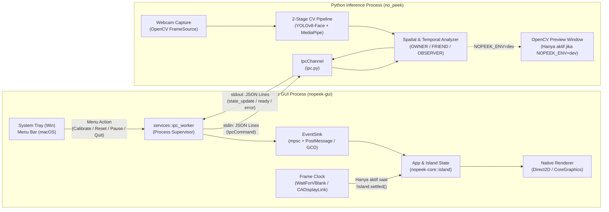

# Rencana Arsitektur dan Implementasi No-Peek Dynamic Island (`plan.md`)

Dokumen ini adalah cetak biru (*blueprint*) teknis lengkap untuk memisahkan dan mengimplementasikan **No-Peek** menjadi dua komponen terpisah yang berkomunikasi melalui IPC (*Inter-Process Communication*):
1. **`inference/` (Python Computer Vision Engine):** Bertugas mengakuisisi kamera, menjalankan deteksi wajah (`YOLOv8n-Face` ONNX) dan estimasi sudut kepala 3D (`MediaPipe Face Landmarker`), menghitung jarak serta klasifikasi peran spasial (`OWNER`, `FRIEND`, `OBSERVER`), lalu mengirimkan status risiko secara *real-time*.
2. **`gui/` (Rust Native Dynamic Island GUI):** Menampilkan indikator visual bergaya *Dynamic Island* yang menempel di tepi atas tengah layar (*docked top-edge notch*), lengkap dengan integrasi *System Tray* pada Windows dan *Menu Bar* pada macOS.

> **KEWAJIBAN MEMBACA `AGENTS.md` SEBELUM IMPLEMENTASI:**
> Seluruh AI agent yang mengimplementasikan rencana ini **wajib** mematuhi aturan rekayasa di [`AGENTS.md`](AGENTS.md) (termasuk larangan *unwired code*, larangan `todo!()` / `#[allow(dead_code)]`, larangan menelan error dengan `unwrap_or_default()` / `except Exception: pass`, larangan *test gaming*, dan kewajiban *Completion Report* yang jujur).
>
> **ATURAN KETAT DESAIN VISUAL (STRICT RULE):**
> **DILARANG KERAS menggunakan karakter Emoji Unicode** (seperti simbol peringatan berbasis teks/font emoji) di bagian mana pun pada UI, teks peringatan IPC, maupun menu. Seluruh indikator grafis **wajib** dirender sebagai jalur vektor SVG (*vector path* pada grid `24x24`) menggunakan mesin *renderer* native (`Direct2D` di Windows dan `Core Graphics` di macOS). Seluruh definisi SVG disediakan secara lengkap di dokumen ini dan di dalam `gui/crates/nopeek-core/src/icons.rs`.

---

## 1. Sumber Referensi Anti-Halusinasi (`../oyenza-studio`)

Implementasi GUI Rust **tidak boleh** menggunakan *framework* web/berat seperti Electron, Tauri, Qt, maupun `winit`/`egui` generik. Seluruh arsitektur windowing, *rendering* GPU/CPU, pegas animasi (*spring physics*), *frame clock* berbasis VBlank, serta *System Tray* / *Menu Bar* diambil langsung dari bagian GUI milik repositori referensi `../oyenza-studio` (`crates/poni-core` dan `crates/poni`).

### Tabel Pemetaan Modul dari `../oyenza-studio` ke `No-Peek/gui`

| File di `../oyenza-studio` | Target di `No-Peek/gui` | Apa yang Diambil & Disesuaikan |
| :--- | :--- | :--- |
| `crates/poni-core/src/geom.rs` | `crates/nopeek-core/src/geom.rs` | Primitif `Point`, `Size`, `Rect`, `Color`, dan `palette` (diambil penuh, disederhanakan untuk palet warna peringatan No-Peek). |
| `crates/poni-core/src/spring.rs` | `crates/nopeek-core/src/spring.rs` | Simulator pegas harmonik teredam (`Spring`, sub-step Euler `240 Hz`) ditambah pegas khusus `Spring::pop` untuk efek *pop text*. |
| `crates/poni-core/src/svgpath.rs` | `crates/nopeek-core/src/svgpath.rs` | Parser path SVG (`M L H V C S Q T A Z`) + fungsi `notch_segments` untuk menggambar siluet Dynamic Island dengan bahu cekung (*concave shoulders*). |
| `crates/poni-core/src/frametime.rs` | `crates/nopeek-core/src/frametime.rs` | Penyelaras waktu frame ke periode *refresh rate* layar (`VsyncTimeline`, `period_for_hz`). |
| `crates/poni/src/island.rs` | `crates/nopeek-core/src/island.rs` | State machine geometri Dynamic Island (`Geom`, `Island`, `SHOULDER = 9.0`), disederhanakan khusus untuk transisi `Idle <-> Alert/Escalated` dan kalkulasi lebar teks dinamis (*fit-text width*). |
| `crates/poni/src/icons.rs` | `crates/nopeek-core/src/icons.rs` | Sistem ikon vektor `24x24` (`Part`, `Icon`), diganti dengan ikon khusus keamanan No-Peek (`EyeWarning`, `ShieldAlert`, `EyeMonitoring`, `EyeOff`, `Calibrate`, `Reset`, `Check`). |
| `crates/poni/src/window.rs` | `crates/nopeek-gui/src/window.rs` | Pembuatan *layered topmost tool window* Win32 (`WS_EX_LAYERED \| WS_EX_TOPMOST \| WS_EX_TOOLWINDOW \| WS_EX_NOACTIVATE \| WS_EX_TRANSPARENT`), pemilihan monitor, dan *thread* VBlank (`IDXGIOutput::WaitForVBlank` / `DwmFlush`). |
| `crates/poni/src/gfx.rs` | `crates/nopeek-gui/src/gfx.rs` | *Renderer* `Direct3D 11` + `Direct2D` + `DirectComposition` + `DirectWrite` (dengan *fallback* DIB software `UpdateLayeredWindowIndirect`), `Canvas::notch`, `Canvas::layered` (untuk komposisi *pop text*), dan `Canvas::measure`. |
| `crates/poni/src/tray.rs` | `crates/nopeek-gui/src/tray.rs` | Ikon *System Tray* Windows (`Shell_NotifyIconW` pada *helper window* tersembunyi) beserta menu konteks klik kanan untuk mengirim perintah IPC ke Python. |
| `crates/poni/src/mac/window.rs` | `crates/nopeek-gui/src/mac/window.rs` | `IslandPanel` (`NSPanel` tanpa bingkai di level `24 + 3 = 27` di atas *Menu Bar* macOS), `CADisplayLink` (mendukung ProMotion `120 Hz`), dan mode *click-through* (`setIgnoresMouseEvents(true)`). |
| `crates/poni/src/mac/notch.rs` | `crates/nopeek-gui/src/mac/notch.rs` | Deteksi fisik kamera *notch* MacBook melalui `NSScreen::safeAreaInsets().top`, `auxiliaryTopLeftArea`, dan `auxiliaryTopRightArea`. |
| `crates/poni/src/mac/gfx.rs` | `crates/nopeek-gui/src/mac/gfx.rs` | *Renderer* `Core Graphics` (`CGContext`) + `Core Text` (`CTLine`, `CTFont`) dengan API `Canvas` yang identik 1:1 dengan versi Windows. |
| `crates/poni/src/mac/menubar.rs` | `crates/nopeek-gui/src/mac/menubar.rs` | Item *Menu Bar* macOS (`NSStatusBar` / `NSStatusItem`) dengan ikon *template* vektor dan menu kontrol IPC dua arah. |

---

## 2. Struktur Direktori Proyek (Hasil Scaffolding Awal)

Repositori dipisahkan secara bersih menjadi direktori `gui/` (Rust Cargo Workspace) dan `inference/` (Python Package), sementara bobot model (`model/`) serta konfigurasi `.env` berada di *root* proyek:

```text
No-Peek/
├── .env                                # Konfigurasi aktif lintas bahasa (Rust & Python)
├── .env.example                        # Template konfigurasi lengkap beserta dokumentasi
├── plan.md                             # Dokumen arsitektur & panduan implementasi ini
├── README.md                           # Dokumentasi utama proyek
├── docs/                               # Dokumentasi riset Computer Vision
├── model/                              # Bobot model lokal (dibaca oleh Python)
│   ├── yolov8n-face.onnx               # Tahap 1: Deteksi multi-wajah + 5 landmark
│   └── face_landmarker.task            # Tahap 2: Estimasi 3D Head Pose MediaPipe
├── inference/                          # [PYTHON] Computer Vision & Temporal Risk Engine
│   ├── pyproject.toml                  # Konfigurasi paket Python & dependensi uv
│   ├── uv.lock
│   ├── README.md
│   ├── src/no_peek/
│   │   ├── __init__.py
│   │   ├── config.py                   # Pemuat .env & konfigurasi runtime Python
│   │   ├── ipc.py                      # Protokol IPC JSON Lines (stdout emitter & stdin reader)
│   │   ├── source.py                   # Akuisisi frame webcam/video (AVFoundation / DirectShow / MSMF)
│   │   ├── detector.py                 # Inferensi YOLOv8n-Face ONNX & C++ NMS
│   │   ├── pose.py                     # Estimasi sudut 3D (yaw/pitch/roll) MediaPipe
│   │   ├── geometry.py                 # Estimasi jarak (cm), zona horizontal, & klasifikasi FRIEND
│   │   ├── analysis.py                 # Tracking IoU, auto-kalibrasi OWNER, & state machine 2s/7s
│   │   ├── preview.py                  # Rendering jendela debug OpenCV (hanya aktif saat NOPEEK_ENV=dev)
│   │   └── main.py                     # Entry point CLI & worker IPC
│   └── tests/
│       ├── test_experiment.py          # Unit test detektor, geometri, pose, & aturan temporal
│       ├── test_player.py              # Integrasi kontrol video player
│       └── test_ipc_config.py          # Unit test parser .env & kanal IPC JSON Lines
└── gui/                                # [RUST] Native Dynamic Island GUI (Windows & macOS)
    ├── Cargo.toml                      # Cargo Workspace (nopeek-core, nopeek-gui)
    └── crates/
        ├── nopeek-core/                # Logika murni bebas OS (dapat diuji di OS mana pun)
        │   ├── Cargo.toml
        │   └── src/
        │       ├── lib.rs
        │       ├── config.rs           # Parser .env & struct GuiConfig
        │       ├── geom.rs             # Point, Size, Rect, Color, palette
        │       ├── spring.rs           # Fisika pegas harmonik (outline & pop text)
        │       ├── svgpath.rs          # Parser path SVG & generator siluet notch_segments
        │       ├── icons.rs            # Definisi ikon vektor 24x24 bebas emoji
        │       ├── ipc.rs              # Kontrak serialisasi serde IpcEvent & IpcCommand
        │       └── island.rs           # State machine Dynamic Island & kalkulasi fit-text width
        └── nopeek-gui/                 # Aplikasi GUI Native (Win32/Direct2D & AppKit/CoreGraphics)
            ├── Cargo.toml
            └── src/
                ├── main.rs             # Entry point & inisialisasi platform
                ├── app.rs              # Event loop utama, penyatuan IPC -> Island -> Render
                ├── events.rs           # EventSink & pesan lintas thread (WM_APP_EVENT / GCD)
                ├── window.rs           # [Windows] Layered click-through window & VBlank thread
                ├── gfx.rs              # [Windows] Direct3D11 + Direct2D + DirectWrite renderer
                ├── tray.rs             # [Windows] System Tray icon & menu konteks IPC
                ├── services/
                │   ├── mod.rs
                │   └── ipc_worker.rs   # Supervisor proses anak Python & reader/writer JSONL
                └── mac/                # [macOS] Modul spesifik macOS (di-mount via #[path])
                    ├── app.rs
                    ├── window.rs       # NSPanel level 27 di atas Menu Bar & CADisplayLink
                    ├── notch.rs        # Adaptasi fisik kamera notch MacBook
                    ├── gfx.rs          # Core Graphics + Core Text renderer
                    └── menubar.rs      # NSStatusBar Menu Bar icon & menu konteks IPC
```

---

## 3. Arsitektur Sistem & Cara Kerja (*End-to-End Workflow*)



### Prinsip Kerja Utama:
1. **Rust sebagai Induk (*Parent Supervisor*):**
   Saat pengguna menjalankan `nopeek-gui`, Rust membaca `.env` di *root* proyek, menginisialisasi jendela *Dynamic Island* dan ikon *System Tray* (Windows) atau *Menu Bar* (macOS), lalu men-*spawn* proses Python (`uv run --project inference no-peek --ipc stdio` atau `.venv/Scripts/python.exe -m no_peek.main --ipc stdio`).
2. **Mode `dev` vs `prod` yang Dikendalikan `.env`:**
   * **`NOPEEK_ENV=dev`:** Python membuka jendela debug OpenCV (`No-Peek experiment`) yang menampilkan *bounding box*, jarak (`cm`), sudut *yaw/pitch/roll*, serta grafik telemetri. Pada saat yang sama, Python tetap mengirim *stream* IPC ke Rust sehingga developer dapat melihat kecocokan antara deteksi kamera dan animasi *Dynamic Island* secara berdampingan.
   * **`NOPEEK_ENV=prod`:** Rust men-*spawn* Python dengan argumen `--headless` (dan flag Win32 `CREATE_NO_WINDOW = 0x08000000` di Windows). Tidak ada jendela konsol maupun jendela OpenCV yang muncul. Aplikasi sepenuhnya berjalan tenang di latar belakang dengan *System Tray* (Windows) / *Menu Bar* (macOS) dan hanya memunculkan *Dynamic Island* di bagian atas layar.
3. **Zero Zombie Process (Pembersihan Deterministik):**
   * **Di Windows:** Proses Python dimasukkan ke dalam Win32 Job Object (`CreateJobObjectW` + `SetInformationJobObject` dengan `JOB_OBJECT_LIMIT_KILL_ON_JOB_CLOSE`). Sekalipun `nopeek-gui.exe` dihentikan paksa lewat Task Manager, kernel Windows otomatis menghentikan proses Python dan melepaskan *handle* kamera.
   * **Di macOS:** Proses Python dijalankan dalam grup proses tersendiri (`process_group(0)`) dan memantau penutupan pipa `stdin` (`EOF`). Saat aplikasi keluar atau di-*quit* dari *Menu Bar*, Rust mengirimkan `{"cmd":"quit"}` diikuti `kill(pid, SIGTERM)` jika belum berhenti dalam `500 ms`.
4. **Idle = 0% CPU & GPU:**
   Mengikuti arsitektur `../oyenza-studio`, *thread* VBlank (`IDXGIOutput::WaitForVBlank` di Windows / `CADisplayLink` di macOS) **diparkir (*parked/paused*)** selama `island.settled() == true`. Artinya, ketika kondisi aman (`MONITORING` atau `PENDING`) dan Dynamic Island diam sebagai tonjolan tipis, proses GUI Rust memakai **0% CPU dan 0% GPU**. *Frame clock* hanya dibangunkan ketika menerima pesan IPC yang mengubah target geometri (`ALERT` / `ESCALATED` / kembali ke `MONITORING`) dan kembali tidur begitu pegas animasi selesai dalam $\approx 0{,}45\text{ detik}$.

---

## 4. Spesifikasi Konfigurasi `.env`

Berkas `.env` diletakkan di *root* repositori (`No-Peek/.env`) dan dibaca baik oleh `inference/src/no_peek/config.py` (Python) maupun `gui/crates/nopeek-core/src/config.rs` (Rust).

| Variabel `.env` | Nilai Default | Komponen Pemakai | Penjelasan Teknis |
| :--- | :--- | :--- | :--- |
| `NOPEEK_ENV` | `dev` | Python & Rust | `dev`: Tampilkan jendela kamera OpenCV untuk debug. `prod`: Sembunyikan jendela kamera (`headless`), jalankan via Tray/Menu Bar. |
| `NOPEEK_IPC_MODE` | `stdio` | Python & Rust | `stdio`: Komunikasi via pipa `stdin`/`stdout` proses anak. `tcp`: Komunikasi via soket TCP lokal untuk *debugging* terpisah. |
| `NOPEEK_IPC_HOST` | `127.0.0.1` | Python & Rust | Alamat *bind/connect* ketika `NOPEEK_IPC_MODE=tcp`. |
| `NOPEEK_IPC_PORT` | `17890` | Python & Rust | Port TCP lokal ketika `NOPEEK_IPC_MODE=tcp`. |
| `NOPEEK_IPC_HEARTBEAT_S` | `2.0` | Python | Interval detik pengiriman *heartbeat* status ketika tidak ada perubahan state. |
| `NOPEEK_CAMERA_INDEX` | `0` | Python | Indeks perangkat webcam lokal (`0`, `1`, dst.). |
| `NOPEEK_CAMERA_WIDTH` | `1280` | Python | Resolusi lebar tangkapan kamera (piksel). |
| `NOPEEK_CAMERA_HEIGHT` | `720` | Python | Resolusi tinggi tangkapan kamera (piksel). |
| `NOPEEK_MIRROR` | `true` | Python | Cerminkan arah horizontal (`LEFT`/`RIGHT`) agar sesuai perspektif pengguna di depan layar. |
| `NOPEEK_YOLO_MODEL` | `model/yolov8n-face.onnx` | Python | Path relatif (terhadap *root* repo) atau absolut ke model detektor wajah ONNX. |
| `NOPEEK_POSE_MODEL` | `model/face_landmarker.task` | Python | Path relatif/absolut ke model MediaPipe 3D Head Pose. |
| `NOPEEK_ONNX_THREADS` | `2` | Python | Jumlah *thread* intra-op CPU untuk ONNX Runtime. |
| `NOPEEK_CONFIDENCE` | `0.50` | Python | Ambang batas skor deteksi wajah `(0.0, 1.0]`. |
| `NOPEEK_IOU` | `0.45` | Python | Ambang batas IoU untuk *Non-Maximum Suppression* (NMS). |
| `NOPEEK_MAX_YAW` | `35.0` | Python | Ambang batas mutlak sudut tolehan kiri-kanan (derajat) untuk dianggap menatap layar. |
| `NOPEEK_MAX_PITCH` | `25.0` | Python | Ambang batas mutlak sudut anggukan atas-bawah (derajat) untuk dianggap menatap layar. |
| `NOPEEK_MAX_ROLL` | `35.0` | Python | Ambang batas mutlak kemiringan kepala (derajat). |
| `NOPEEK_FOV_DEG` | `60.0` | Python | *Field of View* horizontal kamera untuk kalkulasi jarak wajah (`cm`). |
| `NOPEEK_FRIEND_MARGIN_CM` | `25.0` | Python | Toleransi jarak di belakang `OWNER` (`cm`) agar rekan sebelahan tetap diklasifikasikan sebagai `FRIEND`. |
| `NOPEEK_AUTO_CALIBRATE` | `true` | Python | Aktifkan penguncian `OWNER` otomatis saat wajah berada di zona tengah & paling dekat selama $\ge 0{,}6\text{ detik}$. |
| `NOPEEK_IDLE_WIDTH` | `140.0` | Rust GUI | Lebar tonjolan Dynamic Island saat status aman/idle (dalam satuan DIP). |
| `NOPEEK_IDLE_HEIGHT` | `8.0` | Rust GUI | Tinggi tonjolan tipis Dynamic Island saat status aman/idle (dalam satuan DIP). |
| `NOPEEK_ALERT_HEIGHT` | `44.0` | Rust GUI | Tinggi Dynamic Island saat melebar ke bawah pada kondisi `ALERT` / `ESCALATED` (DIP). |
| `NOPEEK_ALERT_MIN_WIDTH` | `240.0` | Rust GUI | Lebar minimum Dynamic Island saat kondisi `ALERT` / `ESCALATED` (DIP). |
| `NOPEEK_ALERT_MAX_WIDTH` | `460.0` | Rust GUI | Lebar maksimum Dynamic Island saat kondisi `ALERT` / `ESCALATED` (DIP). |
| `NOPEEK_ALERT_MARGIN_X` | `18.0` | Rust GUI | Margin horizontal kiri dan kanan di dalam Dynamic Island untuk mengapit ikon + teks (DIP). |
| `NOPEEK_ALERT_MARGIN_Y` | `10.0` | Rust GUI | Margin vertikal atas dan bawah di dalam Dynamic Island saat melebar (DIP). |
| `NOPEEK_TEXT_ALERT` | `Pengintip Terdeteksi` | Python & Rust | Teks dasar saat status mencapai `ALERT` ($\ge 2\text{ detik}$). |
| `NOPEEK_TEXT_ESCALATED` | `Bahaya! Layar Sedang Diintip` | Python & Rust | Teks dasar saat status mencapai `ESCALATED` ($\ge 7\text{ detik}$). |

---

## 5. Protokol Komunikasi IPC & Skema Data JSON Lines

Komunikasi menggunakan format **JSON Lines (NDJSON)**: setiap pesan adalah satu objek JSON utuh yang diakhiri karakter *newline* (`\n`) dan segera di-*flush*.
* **Penting untuk mode `stdio`:** Di sisi Python (`main.py`), apabila `--ipc stdio` aktif, seluruh log diagnostik biasa (atau peringatan C++ MediaPipe/ONNX) harus diarahkan ke `sys.stderr`, sehingga `sys.stdout` murni hanya berisi baris-baris protokol JSON untuk Rust.

### 5.1. Pesan dari Python ke Rust (`stdout` -> `nopeek-core::ipc::IpcEvent`)

#### A. `ready` (Dikirim 1 kali saat kamera dan model selesai dimuat)
```json
{"type":"ready","version":"0.1.0","source":"Webcam 0","headless":true}
```

#### B. `state_update` (Dikirim saat transisi state, perubahan teks/jumlah pengintip, perubahan kalibrasi, atau setiap interval heartbeat 2 detik)
*Contoh saat kondisi aman (`MONITORING` / `PENDING` — Dynamic Island tetap tipis/idle):*
```json
{"type":"state_update","ts":1730742000.125,"level":"MONITORING","alert_active":false,"icon":"none","message":"","observer_count":0,"max_risk_s":0.0,"observers":[],"calibrated":true,"calibration_mode":"AUTO","auto_calibrate":true,"owner_id":1,"paused":false,"fps":29.9}
```

*Contoh saat kondisi `ALERT` ($\ge 2\text{ detik}$ — Dynamic Island melebar ke bawah dengan aksen Kuning/Oranye dan ikon `eye_warning`):*
```json
{"type":"state_update","ts":1730742002.450,"level":"ALERT","alert_active":true,"icon":"eye_warning","message":"Pengintip Terdeteksi (Kiri)","observer_count":1,"max_risk_s":2.32,"observers":[{"id":2,"state":"ALERT","position":"LEFT","distance_cm":92.5,"risk_s":2.32}],"calibrated":true,"calibration_mode":"AUTO","auto_calibrate":true,"owner_id":1,"paused":false,"fps":28.5}
```

*Contoh saat kondisi `ESCALATED` ($\ge 7\text{ detik}$ — Dynamic Island menyesuaikan lebar teks dengan aksen Merah dan ikon `shield_alert`):*
```json
{"type":"state_update","ts":1730742007.810,"level":"ESCALATED","alert_active":true,"icon":"shield_alert","message":"Bahaya! Layar Sedang Diintip (Kiri, 7d+)","observer_count":1,"max_risk_s":7.68,"observers":[{"id":2,"state":"ESCALATED","position":"LEFT","distance_cm":90.0,"risk_s":7.68}],"calibrated":true,"calibration_mode":"AUTO","auto_calibrate":true,"owner_id":1,"paused":false,"fps":28.7}
```

#### C. `calibration` (Dikirim saat terjadi kalibrasi manual/otomatis atau perubahan mode)
```json
{"type":"calibration","calibrated":true,"owner_id":1,"mode":"MANUAL","message":"Owner = ID 1 (MANUAL)."}
```

#### D. `error` (Dikirim bila kamera terputus atau model gagal dimuat)
```json
{"type":"error","fatal":true,"message":"Webcam berhenti memberi frame. Periksa izin/koneksi kamera."}
```

### 5.2. Perintah dari Rust ke Python (`stdin` <- `nopeek-core::ipc::IpcCommand`)

Dikirim ketika pengguna memilih item pada menu *System Tray* (Windows) atau *Menu Bar* (macOS):

| Aksi Pengguna di Tray / Menu Bar | Baris JSON yang Dikirim Rust ke `stdin` Python | Perilaku di Python (`main.py`) |
| :--- | :--- | :--- |
| Klik **"Calibrate Owner Now"** | `{"cmd":"calibrate"}\n` | Memanggil `analyzer.calibrate(visible_ids)` dan mengirimkan event `calibration` + `state_update`. |
| Klik **"Auto-Calibrate Owner"** | `{"cmd":"toggle_auto_calibrate"}\n` | Memanggil `analyzer.toggle_auto_calibrate()` dan memperbarui flag `auto_calibrate`. |
| Klik **"Reset Tracking"** | `{"cmd":"reset"}\n` | Memanggil `analyzer.reset()`, menghapus penguncian `OWNER` dan mereset seluruh timer risiko. |
| Klik **"Pause Detection"** | `{"cmd":"pause"}\n` | Menghentikan sementara pembacaan frame inferensi dan mereset timer agar waktu jeda tidak dihitung. |
| Klik **"Resume Detection"** | `{"cmd":"resume"}\n` | Melanjutkan kembali akuisisi frame dan inferensi kamera. |
| Klik **"Quit No-Peek"** | `{"cmd":"quit"}\n` | Keluar dari loop utama secara bersih (`pose_estimator.close()`, `source.close()`, `cv2.destroyAllWindows()`). |

---

## 6. Desain Visual, Geometri, Animasi, & Ikon Vektor SVG

### 6.1. Geometri Dynamic Island (Docked Top-Edge Notch)

Dynamic Island selalu menempel di tepi paling atas tengah layar (`y = 0.0 DIP`, berpusat pada `cx` layar) dengan bahu melengkung cekung (*concave flare*) sebesar `SHOULDER = 9.0 DIP` di sisi kiri-atas dan kanan-atas (menggunakan `nopeek_core::svgpath::notch_segments`).

1. **Kondisi Idle (`MONITORING` atau `PENDING`):**
   * **Pada layar tanpa *notch* fisik (Windows & monitor eksternal Mac):**
     Berupa tonjolan hitam pekat (`#000000`) yang tipis dan panjang sedang:
     * Lebar: `w = 140.0 DIP` (`NOPEEK_IDLE_WIDTH`)
     * Tinggi: `h = 8.0 DIP` (`NOPEEK_IDLE_HEIGHT`)
     * Radius sudut bawah: `r = 4.0 DIP`
     * Tidak menampilkan teks atau ikon apa pun.
   * **Pada layar MacBook dengan *notch* kamera fisik (`ScreenInfo.notch.is_some()`):**
     Bersembunyi tepat di balik area *notch* fisik kamera (`w = notch.w`, `h = notch.h`) sehingga menyatu sempurna dengan potongan kamera perangkat keras.

2. **Kondisi Peringatan Aktif (`ALERT` $\ge 2\text{ s}$ dan `ESCALATED` $\ge 7\text{ s}$):**
   * **Tinggi (`h`):** Melebar ke bawah menjadi `44.0 DIP` (`NOPEEK_ALERT_HEIGHT`) pada layar tanpa *notch*, atau `notch.h + 44.0 DIP` pada layar MacBook ber-*notch* (sehingga baris teks muncul tepat di bawah kamera fisik MacBook).
   * **Radius Sudut Bawah (`r`):** Membulat menjadi `20.0 DIP`.
   * **Lebar Mengikuti Panjang Teks (*Fit-Text Width* dengan Margin):**
     Sebelum memulai atau memperbarui morfologi pegas, Rust mengukur lebar piksel/DIP teks peringatan menggunakan `Canvas::measure(&text, &text_style, 1000.0).0` lalu menghitung lebar target:
     $$\text{raw\_w} = 2 \times \text{margin\_x} + \text{ICON\_SIZE} + \text{ICON\_TEXT\_GAP} + \lceil \text{measured\_text\_w} \rceil$$
     $$\text{target\_w} = 2 \times \left\lceil \frac{\text{clamp}(\text{raw\_w},\ \text{min\_w},\ \text{max\_w})}{2} \right\rceil$$
     Dengan `margin_x = 18.0 DIP`, `ICON_SIZE = 18.0 DIP`, `ICON_TEXT_GAP = 10.0 DIP`, `min_w = 240.0 DIP`, dan `max_w = 460.0 DIP`. Pembulatan ke angka genap (`2 * ceil(x / 2)`) menjamin koordinat tepi kiri `cx - w/2` dan tepi kanan `cx + w/2` selalu jatuh tepat pada batas piksel utuh (tidak kabur/blur).

### 6.2. Fisika Animasi Ease (Outline) & Pop Text (Konten)

1. **Animasi Outline (Melebar ke Bawah & Samping):**
   Menggunakan simulator pegas orde kedua (`nopeek_core::spring::Spring`) dengan sub-step `240 Hz`:
   * **Saat Melebar (`Idle -> Alert`):**
     * Lebar `w`: `stiffness = 420.0, damping = 30.0` ($\zeta \approx 0.73$)
     * Tinggi `h`: `stiffness = 300.0, damping = 26.0` ($\zeta \approx 0.75$)
     * Radius `r`: `stiffness = 420.0, damping = 41.0` (*critically damped*)
     * *Efek Visual:* Lebar membuka sedikit mendahului tinggi, lalu pulau melebar turun ke bawah dengan *ease-out* lembut dan sedikit *overshoot* alami ($\approx 2\%$).
   * **Saat Menyusut (`Alert -> Idle`):**
     * Lebar `w`: `stiffness = 330.0, damping = 33.0` ($\zeta \approx 0.91$)
     * Tinggi `h`: `stiffness = 420.0, damping = 38.0` ($\zeta \approx 0.93$)
     * *Efek Visual:* Kembali ke tonjolan tipis secara mulus tanpa memantul melewati ketebalan `8.0 DIP`.

2. **Animasi Pop Text (Ikon + Teks):**
   * Saat transisi menuju `ALERT` atau ketika tingkat risiko naik dari `ALERT` ke `ESCALATED`:
     * `content_alpha` di-*snap* ke `0.0` dan `content_scale` di-*snap* ke `0.85`.
     * Setelah tundaan `POP_DELAY_GROW = 0.03 detik` (`30 ms`, memberi waktu bagi badan hitam Dynamic Island untuk mulai membuka), target `content_alpha` diset ke `1.0` (`stiffness = 700.0, damping = 52.9`) dan target `content_scale` diset ke `1.0` (`stiffness = 520.0, damping = 32.0`, menghasilkan efek *pop* elastis `0.85 -> 1.03 -> 1.00`).
   * **Teknik Rendering Bebas Jitter (`Canvas::layered`):**
     Mengikuti `oyenza-studio/crates/poni/src/gfx.rs#L2063-L2110`, ikon dan teks digambar ke dalam *offscreen layer* pada ukuran 100%, lalu *layer* tersebut digambar ke layar menggunakan matriks transformasi skala `Matrix3x2::scale(scale, scale, center)` dan opasitas `content_alpha`. Dengan cara ini, huruf tidak mengalami *font re-hinting* yang bergetar saat sedang membesar (*pop*).

### 6.3. Palet Warna & Tipografi Peringatan

| Elemen | State `ALERT` ($\ge 2\text{ s}$) | State `ESCALATED` ($\ge 7\text{ s}$) |
| :--- | :--- | :--- |
| **Warna Badan Pulau** | Hitam Pekat `#000000` (`alpha = 1.0`) | Hitam Pekat `#000000` (`alpha = 1.0`) |
| **Garis Tepi Bawah/Samping** | Putih Transparan `rgba(255, 255, 255, 0.08)` | Merah Transparan `rgba(255, 69, 58, 0.35)` |
| **Ikon Vektor SVG (Kiri)** | `Icon::EyeWarning` dengan warna Amber `#FF9F0A` | `Icon::ShieldAlert` dengan warna Merah `#FF453A` |
| **Teks Peringatan (Kanan)** | Putih `#F5F5F5` (`alpha = 0.96`), `13.5 DIP Semibold` | Merah Muda Terang / Putih `#FFF0EF` (`13.5 DIP Bold`) |

### 6.4. Spesifikasi Lengkap Ikon Vektor SVG (Bebas Emoji)

Seluruh ikon dirancang di atas kanvas `viewBox="0 0 24 24"` dengan ketebalan garis `stroke-width="2"`, `stroke-linecap="round"`, dan `stroke-linejoin="round"`. Data path di bawah ini telah ditanamkan langsung di `gui/crates/nopeek-core/src/icons.rs`.

#### 1. `Icon::EyeWarning` (Digunakan saat `ALERT` $\ge 2\text{ detik}$)
```xml
<svg xmlns="http://www.w3.org/2000/svg" viewBox="0 0 24 24" fill="none" stroke="#FF9F0A" stroke-width="2" stroke-linecap="round" stroke-linejoin="round">
  <!-- Kontur kelopak mata (stroke) -->
  <path d="M2.5 12C4.8 7.2 8.2 5 12 5s7.2 2.2 9.5 7c-2.3 4.8-5.7 7-9.5 7s-7.2-2.2-9.5-7Z" />
  <!-- Batang tanda seru di dalam mata (stroke) -->
  <path d="M12 9v3.5" />
  <!-- Titik tanda seru di dalam mata (fill) -->
  <path fill="#FF9F0A" stroke="none" d="M12 14.5a1 1 0 1 0 0 2a1 1 0 1 0 0-2Z" />
</svg>
```

#### 2. `Icon::ShieldAlert` (Digunakan saat `ESCALATED` $\ge 7\text{ detik}$)
```xml
<svg xmlns="http://www.w3.org/2000/svg" viewBox="0 0 24 24" fill="none" stroke="#FF453A" stroke-width="2" stroke-linecap="round" stroke-linejoin="round">
  <!-- Perisai keamanan (stroke) -->
  <path d="M12 3l8 3.5v5.5c0 5-3.4 8.8-8 10c-4.6-1.2-8-5-8-10V6.5L12 3Z" />
  <!-- Batang tanda seru peringatan (stroke) -->
  <path d="M12 8v4.5" />
  <!-- Titik tanda seru peringatan (fill) -->
  <path fill="#FF453A" stroke="none" d="M12 15a1.1 1.1 0 1 0 0 2.2a1.1 1.1 0 1 0 0-2.2Z" />
</svg>
```

#### 3. `Icon::EyeMonitoring` (Status Aktif / Menu Bar & System Tray)
```xml
<svg xmlns="http://www.w3.org/2000/svg" viewBox="0 0 24 24" fill="none" stroke="#FFFFFF" stroke-width="2" stroke-linecap="round" stroke-linejoin="round">
  <path d="M2.5 12C4.8 7.2 8.2 5 12 5s7.2 2.2 9.5 7c-2.3 4.8-5.7 7-9.5 7s-7.2-2.2-9.5-7Z" />
  <path d="M9 12a3 3 0 1 0 6 0a3 3 0 1 0-6 0" />
</svg>
```

#### 4. `Icon::EyeOff` (Status Dijeda / Paused)
```xml
<svg xmlns="http://www.w3.org/2000/svg" viewBox="0 0 24 24" fill="none" stroke="#9E9E9E" stroke-width="2" stroke-linecap="round" stroke-linejoin="round">
  <path d="M2.5 12C4.8 7.2 8.2 5 12 5s7.2 2.2 9.5 7c-2.3 4.8-5.7 7-9.5 7s-7.2-2.2-9.5-7Z" />
  <path d="M4 4l16 16" />
</svg>
```

#### 5. `Icon::Calibrate` & `Icon::Reset`
```xml
<!-- Icon::Calibrate -->
<svg xmlns="http://www.w3.org/2000/svg" viewBox="0 0 24 24" fill="none" stroke="#FFFFFF" stroke-width="2" stroke-linecap="round" stroke-linejoin="round">
  <path d="M5 12a7 7 0 1 0 14 0a7 7 0 1 0-14 0" />
  <path d="M12 2v3M12 19v3M2 12h3M19 12h3" />
  <path fill="#FFFFFF" stroke="none" d="M10.5 12a1.5 1.5 0 1 0 3 0a1.5 1.5 0 1 0-3 0" />
</svg>

<!-- Icon::Reset -->
<svg xmlns="http://www.w3.org/2000/svg" viewBox="0 0 24 24" fill="none" stroke="#FFFFFF" stroke-width="2" stroke-linecap="round" stroke-linejoin="round">
  <path d="M4 12a8 8 0 1 0 2.3-5.6L4 8.5" />
  <path d="M4 4v4.5h4.5" />
</svg>
```

---

## 7. Implementasi Spesifik Platform: Windows vs macOS

### 7.1. Implementasi Windows (`Win32` + `Direct2D` + `DirectComposition` + `System Tray`)

Diadaptasi langsung dari `../oyenza-studio/crates/poni/src/{window.rs, gfx.rs, tray.rs}`:

1. **Konfigurasi Jendela Dynamic Island (`window.rs`):**
   * Karena Dynamic Island No-Peek tidak membutuhkan interaksi klik atau *hover* (100% *click-through*), kita tidak memerlukan pemisahan jendela *hit-mask* dan *visual*. Cukup satu jendela `NoPeek.Island` dengan *extended style*:
     ```rust
     WS_EX_LAYERED | WS_EX_TRANSPARENT | WS_EX_TOPMOST | WS_EX_TOOLWINDOW | WS_EX_NOACTIVATE
     ```
   * **Penjelasan Flag:**
     * `WS_EX_LAYERED`: Memungkinkan komposisi per-piksel alpha transparan (`DirectComposition` / `UpdateLayeredWindowIndirect`).
     * `WS_EX_TRANSPARENT`: Membuat seluruh area jendela **100% tembus klik (*click-through*)** ke aplikasi di bawahnya (misal tab *browser* tetap bisa diklik meskipun tertutup pulau).
     * `WS_EX_TOPMOST`: Selalu berada di lapisan paling atas layar.
     * `WS_EX_TOOLWINDOW`: Menyembunyikan aplikasi dari *Taskbar* dan daftar `Alt+Tab`.
     * `WS_EX_NOACTIVATE`: Tidak pernah mencuri fokus *keyboard* dari aplikasi aktif pengguna.
   * **Ukuran Jendela Tetap (*Fixed Canvas Size*):**
     Jendela dibuat satu kali dengan ukuran kanvas maksimum:
     `canvas_w = (alert_max_width + 2 * (SHOULDER + CANVAS_MARGIN)) * scale` dan `canvas_h = (alert_height + CANVAS_MARGIN) * scale`, diposisikan di tengah atas monitor utama (`(monitor_w - canvas_w) / 2, monitor_top`). Dengan ukuran jendela yang tetap, morfologi pegas tidak pernah memanggil `SetWindowPos`, sehingga titik tengah pulau tidak pernah bergeser 1 piksel pun.

2. **Rendering Direct2D & Frame Clock VBlank (`gfx.rs` & `window.rs`):**
   * **Jalur Utama (GPU):** `ID3D11Device` -> `IDXGISwapChain1` (`DXGI_ALPHA_MODE_PREMULTIPLIED`) -> `IDCompositionDevice::CreateTargetForHwnd` -> `ID2D1DeviceContext`.
   * **Jalur Fallback (Software DIB):** Jika `DirectComposition` gagal (misal pada VM tanpa driver GPU), otomatis beralih ke `CreateDIBSection` + `UpdateLayeredWindowIndirect` yang hanya menyalin *dirty rect* area pulau.
   * **VBlank Clock:** Thread khusus memanggil `IDXGIOutput::WaitForVBlank()` (atau fallback `DwmFlush()`) lalu mengirim `PostMessageW(hwnd, WM_APP_FRAME, 0, vblank_ns)`. Saat `island.settled()` bernilai `true`, thread ini tidur di `Condvar::wait` hingga dibangunkan oleh event IPC baru.

3. **System Tray Windows (`tray.rs`):**
   * Jendela tersembunyi `NoPeek.Helper` mendaftarkan ikon di *Notification Area* menggunakan `Shell_NotifyIconW(NIM_ADD, &nid)` dengan pesan callback `WM_APP_TRAY`.
   * Saat pengguna melakukan klik kanan (`WM_RBUTTONUP` / `WM_CONTEXTMENU`) pada ikon Tray, `CreatePopupMenu()` + `TrackPopupMenu()` menampilkan struktur menu berikut:
     * `Status: Monitoring (Owner Locked - AUTO)` *(Info non-interaktif, abu-abu)*
     * `Mode: Production (Headless)` atau `Mode: Development (Camera Preview)` *(Info)*
     * `---` *(Separator)*
     * `Calibrate Owner Now` -> mengirim `{"cmd":"calibrate"}` ke Python
     * `[x] Auto-Calibrate Owner` -> mengirim `{"cmd":"toggle_auto_calibrate"}`
     * `Reset Tracking` -> mengirim `{"cmd":"reset"}`
     * `---` *(Separator)*
     * `Pause Detection` / `Resume Detection` -> mengirim `{"cmd":"pause"}` / `{"cmd":"resume"}`
     * `---` *(Separator)*
     * `Quit No-Peek` -> mengirim `{"cmd":"quit"}`, menghapus ikon Tray (`NIM_DELETE`), dan keluar.

---

### 7.2. Implementasi macOS (`AppKit` + `Core Graphics` + `Core Text` + `Menu Bar` via `objc2`)

Diadaptasi langsung dari `../oyenza-studio/crates/poni/src/mac/{window.rs, notch.rs, gfx.rs, menubar.rs}`:

1. **Konfigurasi `NSPanel` di Atas Menu Bar (`mac/window.rs`):**
   * Menggunakan `objc2` dan `objc2-app-kit` untuk membuat subkelas `NSPanel` (`NoPeekIslandPanel`) dengan:
     * Style mask: `NSWindowStyleMask::Borderless | NSWindowStyleMask::NonActivatingPanel`
     * Level jendela: `const ISLAND_LEVEL: isize = 24 + 3;` (`27`, berada di atas *Menu Bar* macOS yang memiliki level `24`, sehingga pulau menempel mulus dari tepi atas layar melintasi *Menu Bar*).
     * Perilaku koleksi (*Collection Behavior*):
       ```rust
       NSWindowCollectionBehavior::CanJoinAllSpaces
           | NSWindowCollectionBehavior::Stationary
           | NSWindowCollectionBehavior::FullScreenAuxiliary
           | NSWindowCollectionBehavior::IgnoresCycle
       ```
     * Transparansi & Click-Through:
       * `panel.setOpaque(false)`
       * `panel.setBackgroundColor(Some(&NSColor::clearColor()))`
       * `panel.setHasShadow(false)`
       * `panel.setIgnoresMouseEvents(true)` — menjadikan seluruh panel 100% *click-through* tanpa perlu *global mouse monitor*.

2. **Deteksi & Integrasi Fisik Kamera Notch MacBook (`mac/notch.rs`):**
   * Mengambil layar utama melalui `NSScreen::screens(mtm)` dan memeriksa apakah layar memiliki *camera housing notch*:
     ```rust
     let inset = screen.safeAreaInsets().top;
     let (left_aux, right_aux) = (screen.auxiliaryTopLeftArea(), screen.auxiliaryTopRightArea());
     let notch_w = frame.size.width - left_aux.size.width - right_aux.size.width;
     let has_notch = inset > 0.0 && notch_w > 40.0 && notch_w < frame.size.width / 2.0;
     ```
   * **Perilaku Adaptif di MacBook Ber-Notch:**
     * **Saat Idle (`MONITORING`):** Target geometri diset ke `Geom::new(notch.w, notch.h, 10.0)` sehingga pulau tersembunyi persis di dalam area hitam kamera fisik MacBook.
     * **Saat `ALERT` / `ESCALATED`:** Tinggi target diset ke `notch.h + cfg.alert_height`, dan lebar target diset ke `fit_alert_width(measured_text_w, cfg).max(notch.w + 24.0)`. Konten ikon + teks digambar pada area di bawah `y = notch.h` (`Rect::new(body.x, notch.h, body.w, cfg.alert_height)`), sehingga Dynamic Island tampak memanjang turun keluar dari *notch* kamera fisik MacBook secara alami.
   * **Perilaku di Monitor Eksternal Mac / iMac (Tanpa Notch):**
     Sama persis seperti Windows: saat Idle berupa tonjolan tipis `140 x 8 DIP`, dan saat Alert memanjang turun menjadi `fit_w x 44 DIP`.

3. **Rendering Core Graphics & Frame Clock `CADisplayLink` (`mac/gfx.rs` & `mac/window.rs`):**
   * `NoPeekIslandView` (`NSView` dengan `isFlipped() -> true` agar koordinat `y = 0` berada di tepi atas layar, identik dengan Direct2D di Windows).
   * Menggunakan `CADisplayLink` pada `NSView` (`view.displayLinkWithTarget_selector(...)`) dengan `CAFrameRateRange { minimum: 60.0, maximum: 120.0, preferred: 120.0 }` untuk mendukung layar ProMotion `120 Hz`.
   * Saat `island.settled()` bernilai `true`, `display_link.setPaused(true)` dipanggil agar tidak ada pemanggilan `drawRect:` saat diam.

4. **Menu Bar Item & Kebijakan Aplikasi Tanpa Ikon Dock (`mac/menubar.rs`):**
   * Saat inisialisasi `NSApplication`, kebijakan aktivasi diset ke `NSApplicationActivationPolicy::Accessory` (atau `LSUIElement = true` pada `Info.plist` saat dibundel menjadi `.app`), sehingga aplikasi **tidak memunculkan ikon di Dock macOS** dan hanya hidup di *Menu Bar* kanan atas.
   * `NSStatusBar::systemStatusBar().statusItemWithLength(NSVariableStatusItemLength)` menggambar ikon `Icon::EyeMonitoring` (`18x18 pt`) dengan `NSImage::setTemplate(true)` agar otomatis menyesuaikan mode terang/gelap macOS.
   * Klik pada ikon *Menu Bar* membuka `NSMenu` dengan daftar aksi yang identik dengan *System Tray* Windows (`Calibrate Owner Now`, `Auto-Calibrate Owner`, `Reset Tracking`, `Pause/Resume Detection`, `Quit No-Peek`).

5. **Izin Kamera macOS (`NSCameraUsageDescription`):**
   * Karena di macOS proses Python di-*spawn* sebagai *child process* dari `nopeek-gui`, sistem TCC (*Transparency, Consent, and Control*) macOS mewariskan izin akses kamera dari *parent bundle* (`No-Peek.app`).
   * Oleh karena itu, berkas `Info.plist` pada bundel macOS wajib menyertakan:
     ```xml
     <key>LSUIElement</key>
     <true/>
     <key>NSCameraUsageDescription</key>
     <string>No-Peek menggunakan kamera secara lokal untuk mendeteksi pengintip di belakang layar Anda tanpa menyimpan atau mengirim gambar ke mana pun.</string>
     ```

---

## 8. Modifikasi pada Sisi Python (`inference/src/no_peek/main.py`)

Agar Python mendukung eksekusi mandiri maupun eksekusi sebagai *worker* IPC di bawah Rust, `inference/src/no_peek/main.py` diintegrasikan dengan `config.py` dan `ipc.py` melalui langkah berikut:

1. **Resolusi Konfigurasi Berjenjang (`CLI Args > Environment / .env > Default`):**
   * Pada awal `arguments()`, muat `AppConfig.from_env()` dari `.env` di *root* proyek.
   * Tambahkan argumen CLI `--ipc` dengan pilihan `none`, `stdio`, atau `tcp` (default mengikuti `NOPEEK_IPC_MODE` dari `.env`).
   * Nilai default `--headless` otomatis bernilai `True` apabila `NOPEEK_ENV=prod` di `.env` (kecuali di-*override* secara eksplisit).
2. **Integrasi `IpcChannel` di dalam Loop Utama (`run()`):**
   * Jika mode IPC aktif (`stdio` atau `tcp`), alihkan `print()` log biasa ke `sys.stderr` agar `sys.stdout` bersih untuk JSON Lines.
   * Panggil `ipc.start_reader()` sebelum loop kamera dimulai, lalu kirim pesan `{"type":"ready", ...}` setelah `FrameSource` terbuka.
   * Pada setiap iterasi loop:
     1. Periksa perintah masuk dari Rust dengan `while (cmd := ipc.poll_command()) is not None:` dan petakan ke aksi `calibrate`, `toggle_auto_calibrate`, `reset`, `pause`, `resume`, atau `quit`.
     2. Setelah `observations = analyzer.update(...)`, bangun payload dengan `build_state_payload(...)` dan panggil `ipc.emit_state_if_needed(payload, heartbeat_s=cfg.ipc_heartbeat_s)`.

---

## 9. Roadmap Implementasi Bertahap (Untuk Eksekusi Selanjutnya)

Model AI atau engineer yang melanjutkan implementasi dari *scaffolding* ini harus mengikuti urutan tahapan berikut:

### Tahap 1: Finalisasi Worker IPC di Python (`inference/`)
1. Perbarui `inference/src/no_peek/main.py` agar membaca `AppConfig.from_env()` dari `no_peek.config` dan mengintegrasikan `IpcChannel` dari `no_peek.ipc`.
2. Pastikan saat `NOPEEK_ENV=dev`, jendela OpenCV `No-Peek experiment` tampil normal sekaligus mengirimkan baris JSONL ke `stdout`/TCP; sedangkan saat `NOPEEK_ENV=prod`, jendela OpenCV tidak dibuat (`headless=True`).
3. Jalankan pengujian `uv run --project inference python -m unittest discover -s inference/tests -v` untuk memastikan seluruh unit test lolos.

### Tahap 2: Implementasi Supervisor IPC & State di Rust (`gui/crates/nopeek-gui`)
1. Buat `gui/crates/nopeek-gui/src/events.rs` (mengadaptasi `EventSink` dari `../oyenza-studio/crates/poni/src/events.rs`) yang membungkus `std::sync::mpsc::Sender<AppEvent>` dan membangunkan *UI thread* (`PostMessageW(hwnd, WM_APP_EVENT, 0, 0)` di Windows / `Queue::main().exec_async` di macOS).
2. Buat `gui/crates/nopeek-gui/src/services/ipc_worker.rs`:
   * Menemukan interpreter Python (`.venv/Scripts/python.exe` di Windows atau `.venv/bin/python` di macOS) dan menjalankan `-m no_peek.main --ipc stdio`.
   * Pada Windows, bungkus proses anak ke dalam Win32 Job Object (`JOB_OBJECT_LIMIT_KILL_ON_JOB_CLOSE`) dan tambahkan `CREATE_NO_WINDOW` bila `cfg.env_mode == EnvMode::Prod`.
   * Membaca `BufReader::new(child.stdout).lines()`, mem-parsing setiap baris menggunakan `nopeek_core::ipc::IpcEvent::parse_line`, dan mengirimkannya ke `EventSink`.
   * Menyediakan metode `send_command(&self, cmd: IpcCommand)` yang menulis `cmd.to_jsonl()` ke `child.stdin`.

### Tahap 3: Implementasi Renderer & Windowing Windows (`gui/crates/nopeek-gui/src/`)
1. Salin dan rampingkan `window.rs`, `gfx.rs`, dan `tray.rs` dari `../oyenza-studio/crates/poni/src/`:
   * Hapus ketergantungan pada `studio-usage`, halaman-halaman (`pages/*`), serta tema yang tidak diperlukan.
   * Gunakan `nopeek_core::{geom, icons, island, spring, svgpath}`.
2. Di `app.rs` (fungsi `paint`):
   * Gambar siluet pulau menggunakan `canvas.notch(body, g.r, SHOULDER, palette::ISLAND, border_color)`.
   * Jika `island.content_alpha() > 0.002`:
     * Buka *offscreen layer* `canvas.layered(body, island.content_alpha(), scale_matrix, |c| { ... })`.
     * Gambar `c.icon(island.icon, icon_rect, icon_color)` dan `c.text(&island.text, text_rect, &text_style)`.

### Tahap 4: Implementasi Renderer & Windowing macOS (`gui/crates/nopeek-gui/src/mac/`)
1. Salin dan rampingkan `mac/window.rs`, `mac/notch.rs`, `mac/gfx.rs`, `mac/menubar.rs`, dan `mac/app.rs` dari `../oyenza-studio/crates/poni/src/mac/`.
2. Pastikan `cargo check --manifest-path gui/Cargo.toml` berhasil di Windows maupun macOS (atau gunakan target *cross-check* `x86_64-pc-windows-gnu` dan `aarch64-apple-darwin`).

---

## 10. Status Saat Ini vs Kriteria Selesai (*Definition of Done* sesuai `AGENTS.md`)

### A. Yang Sudah Selesai pada Tahap Scaffolding Ini (`[x]`)
- [x] **Pemisahan Direktori Scaffolding:** `inference/` (Python) dan `gui/` (Rust Cargo Workspace) telah dipisahkan, dengan `.env`, `.env.example`, `AGENTS.md`, dan `model/` berada di *root*.
- [x] **Aturan Bebas Emoji Unicode:** Tidak ada satu pun karakter emoji unicode di dalam kode sumber maupun `plan.md`; seluruh indikator menggunakan path vektor SVG `24x24` (`EyeWarning`, `ShieldAlert`, `EyeMonitoring`, `EyeOff`, `Calibrate`, `Reset`, `Check`).
- [x] **Core Logic & Kontrak IPC (`nopeek-core` & `no_peek/{config,ipc}.py`):** Modul geometri, pegas animasi, parser SVG, kalkulasi *fit-text width*, pembaca `.env`, dan serialisasi JSON Lines IPC telah diimplementasikan dan lulus unit test (`19 passed` di Python, `3 passed` di Rust).

### B. Yang Harus Diselesaikan Sebelum Mengklaim Aplikasi Selesai Penuh (`[ ]` — Wajib End-to-End Wiring)
Sesuai aturan **No Unwired Code** di [`AGENTS.md`](AGENTS.md), AI agent yang mengeksekusi Tahap 1–4 **dilarang** mengklaim tugas selesai sebelum daftar berikut terpenuhi secara *end-to-end*:
- [ ] **Tahap 1 Terhubung Penuh:** `inference/src/no_peek/main.py` telah memanggil `AppConfig.from_env()` dan `IpcChannel`, mengirim `ready` dan `state_update` ke `stdout`, serta mengeksekusi perintah `calibrate`, `toggle_auto_calibrate`, `reset`, `pause`, `resume`, dan `quit` dari `stdin`.
- [ ] **Tahap 2 Terhubung Penuh:** `gui/crates/nopeek-gui/src/services/ipc_worker.rs` benar-benar men-*spawn* proses Python (dengan Win32 Job Object + `CREATE_NO_WINDOW` saat `prod` di Windows, dan *process group* di macOS), membaca `stdout` JSON Lines, dan meneruskan `IpcEvent` ke *UI thread*.
- [ ] **Tahap 3 Terhubung Penuh (Windows):** `gui/crates/nopeek-gui/src/main.rs` membuat jendela `NoPeek.Island` (`WS_EX_LAYERED | WS_EX_TRANSPARENT | WS_EX_TOPMOST | WS_EX_TOOLWINDOW | WS_EX_NOACTIVATE`), merender siluet *notch* dan animasi *pop text* dengan `Direct2D`/`DirectComposition`, memarkir *VBlank thread* saat `island.settled()`, dan menampilkan menu *System Tray* yang fungsional.
- [ ] **Tahap 4 Terhubung Penuh (macOS):** Modul `gui/crates/nopeek-gui/src/mac/` membuat `NoPeekIslandPanel` (`NSPanel` level 27 di atas *Menu Bar*), mengadaptasi ukuran *camera notch* fisik MacBook, merender dengan `Core Graphics` + `Core Text` + `CADisplayLink`, dan menampilkan item *Menu Bar* (`NSStatusBar`).
